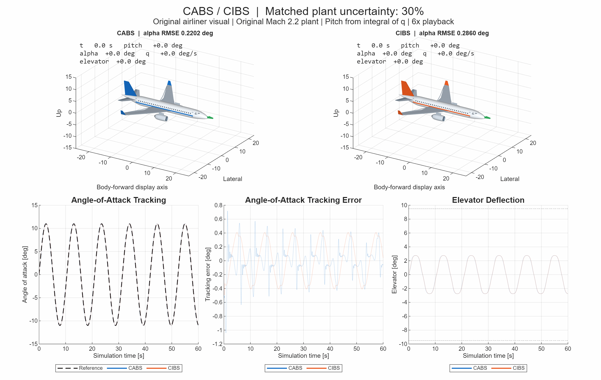

# Command-Filtered Adaptive and Incremental Backstepping Flight Control

MATLAB and Simulink experiments comparing command-filtered adaptive backstepping (CABS) and command-filtered incremental backstepping (CIBS) for nonlinear longitudinal flight control. Both controllers track an angle-of-attack command using a filtered virtual pitch-rate command and a bounded elevator input.

## Controller responses in 3D



The GIF shows freshly simulated responses over **60 seconds**, played at **6x speed**. Both controllers use the same physical plant with **30% maximum nonuniform pitch-parameter uncertainty**. CABS starts with nominal parameter estimates and adapts; CIBS retains nominal control effectiveness and uses measured pitch acceleration.

The airliner is an original procedural **Airbus-style illustration**, not an Airbus aerodynamic model or an official Airbus asset. The underlying project plant runs at **Mach 2.2**. It contains angle of attack and pitch rate, with no roll, yaw, position, or altitude dynamics. Displayed pitch is reconstructed as `cumtrapz(t,q)` with zero initial pitch; the green velocity-direction arrow uses `gamma = pitch - alpha`. The airframes remain at the display origin. Elevator motion follows the applied command without visual amplification.

The lower plots show angle-of-attack tracking, tracking error, and elevator deflection. Faint curves show the complete response; solid curves progress with the animation. [Static preview](docs/media/controller_comparison.png) · [Numeric metrics](docs/media/controller_metrics.csv).

| Controller | Alpha RMSE [deg] | Pitch-rate tracking RMSE [deg/s] | Elevator RMS [deg] | Saturation [%] |
| --- | ---: | ---: | ---: | ---: |
| CABS | 0.22017 | 1.10546 | 2.08599 | 0 |
| CIBS | 0.28596 | 0.71926 | 2.08580 | 0 |

These values cover all 6,001 samples, including startup. Pitch-rate error is measured against the command-filter output `qc`. Results describe this particular experiment, not a general ranking of the controllers.

## Run the animation

Open MATLAB in the repository folder and run:

```matlab
D = animate_airbus_controllers();
```

The animation uses base MATLAB graphics and the existing MATLAB simulator. No external 3D asset, Aerospace Toolbox, or Simulink license is needed for this path. It was run and verified using MATLAB R2025a.

```matlab
% Export without showing the figure; defaults reproduce the README example.
D = animate_airbus_controllers(Visible='off', Fps=12, Speed=6);

% Nominal plant, or a shorter preview in a separate folder.
D = animate_airbus_controllers(Uncertainty=0, Duration=10, ...
    OutputDir=fullfile(pwd,'results','preview'));
```

`Uncertainty` accepts values from 0 to 0.30 and scales the full-nonuniform pattern defined in `setup_project.m`. `Duration` changes simulated time; `Fps` and `Speed` change playback sampling only. Simulation continues to use the configured 0.01 s integration step.

Default exports:

- `docs/media/controller_comparison.gif`: looping 3D animation with synchronized plots.
- `docs/media/controller_comparison.png`: midpoint preview.
- `docs/media/controller_metrics.csv`: full-run controller metrics.
- `results/animation/controller_animation.mat`: local simulation logs, configuration, and reconstructed pitch, excluded from Git as reproducible output.

## Run the original studies

In `run_project.m`, set `MODE`, then run the script:

| Mode | Experiment |
| --- | --- |
| `CABS_NOMINAL` | Perfect-model CABS baseline |
| `CABS_COMPARE` | Perfect model, incorrect model with adaptation off, and incorrect model with adaptation on |
| `CIBS_NOMINAL` | Nominal CIBS baseline |
| `CIBS_ROBUSTNESS` | Uniform plant-parameter errors of +/-10% through +/-60% |
| `CIBS_NONUNIFORM` | Drift-only, control-effectiveness-only, and full nonuniform errors at 10%, 20%, and 30% |
| `REPORT_PLOTS` | Report figures from previously saved CABS and uniform CIBS results |
| `ALL` | CABS comparison, both CIBS robustness studies, and report plots |

For a direct comparison on identical uncertain plants, run:

```matlab
compare_CABS_CIBS_matched_uncertainty
```

This tests a nominal baseline and all three nonuniform uncertainty families at 10%, 20%, and 30%, then saves the results under `results/`. The original plotting scripts open figures and save selected study/report exports.

For the separate Simulink implementation (requires Simulink), select `simCase` in `init_AE4311_simulink.m`, then run:

```matlab
init_AE4311_simulink
open_system('AE4311_CABS_CIBS.slx')
sim('AE4311_CABS_CIBS.slx')
```

The README GIF is generated by the MATLAB simulator, not by the Simulink model.

## Model and control implementation

The plant states are `x = [alpha; q]` and the control input is elevator deflection `delta`. `plant.m` evaluates nonlinear normal-force and pitching-moment polynomials and advances the states with fixed-step fourth-order Runge-Kutta:

```text
alphaDot = q + Az / VT
qDot     = Kq * (Cm(alpha, M, thetaPlant) + bm(M, thetaPlant) * delta)
```

Internal angles use radians. Physical parameters use the source model's imperial unit convention (for example, `g = 32.2` and `VT = 3109.3`); plots convert angular quantities to degrees. The default command is `11 deg * sin(0.6*t)` and the applied elevator is limited to +/-9.5 deg.

Both controllers share backstepping gains `c1 = 4`, `c2 = 8`, a second-order command filter (`wn = 20 rad/s`, `zeta = 0.7`), and a command-filter compensation state. CABS estimates seven normalized pitch parameters with componentwise bounds `[0.4, 1.6]` and freezes adaptation during saturation. CIBS computes incremental elevator updates from measured pitch acceleration and nominal control effectiveness. The MATLAB experiments use ideal plant measurements, without sensor-noise or actuator-dynamics models.

| File | Role |
| --- | --- |
| `setup_project.m` | Plant constants, controller settings, uncertainty patterns |
| `plant.m` | Nonlinear dynamics, measured outputs, RK4 propagation |
| `controller_cabs.m` | Model-based control and parameter adaptation |
| `controller_cibs.m` | Incremental control law |
| `simulate_controller.m` | Shared simulation, logging, and metrics |
| `animate_airbus_controllers.m` | Matched simulation, procedural mesh, animation, GIF export |
| `run_project.m` | Original experiment entry point |
| `compare_CABS_CIBS_matched_uncertainty.m` | Direct matched-plant comparison |
| `plot_dashboard.m`, `plot_report_figures.m` | Response dashboards and report figures |
| `plot_cibs_nonuniform_study.m` | Nonuniform robustness figures |
| `init_AE4311_simulink.m`, `AE4311_CABS_CIBS.slx` | Simulink initialization and model |

## License

Released under the [MIT License](LICENSE).
